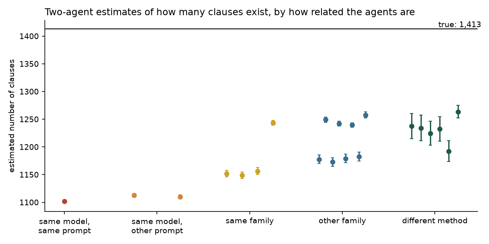
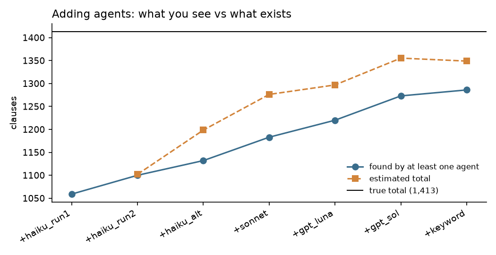
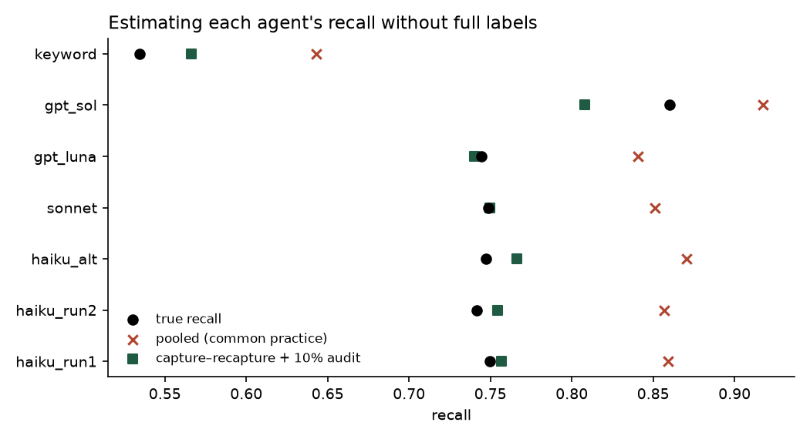

# eval-capture-recapture

**Estimate what your AI eval never saw.**

Most evals for extraction agents measure precision: is what the agent found correct? They rarely measure recall, because nobody knows how many items exist in total. Capture–recapture is a method ecologists have used since the 1890s to count fish in a lake without draining it. It can estimate that total from the overlap between independent sources, such as two agents or an agent and a reviewer.

This repo tests the method on a task where the answer is known. Seven agents extract clauses from 294 lawyer-labelled contracts ([CUAD](https://www.atticusprojectai.org/cuad)), and every estimate is compared with the true count.

Companion code for the article *What Counting UK Forests Taught Me About Evaluating AI Agents* (link coming soon).

## Main findings



**Every pair of agents underestimates the total, and the more alike two agents are, the worse it gets.**
- True count: 1,413 clauses.
- Two runs of the same model estimate 1,102.
- Pairs from different model families estimate 1,173 to 1,258.
- The 95% intervals are narrow, and for cross-family pairs they contain the truth in only 1 of 80 checks.



**More agents and estimators built for uneven difficulty close most of the gap.** With all seven agents, the median error per clause type falls from about 12% for a pair to about 5%. The second-order jackknife and the log-linear model both do this.



**You can estimate each agent's recall without labels.** Pooled recall treats everything any agent found as the full truth, and it overstates every agent by 6 to 12 points. Capture–recapture plus a 10% hand audit has a mean error of 1.8 points against 10.2 for pooling, and it is better in 94% of 1,000 bootstrap resamples.

All results, including the hypotheses that failed, are in [RESULTS.md](RESULTS.md). The hypotheses were written down and committed before the full run, in [PREREGISTRATION.md](PREREGISTRATION.md).

## Use the estimators on your own eval

The estimators in `src/crc/estimators.py` work on any 0/1 matrix where rows are items and columns are sources (agents, reviewers or rules):

```python
import numpy as np
from crc import chapman, jackknife_mh, loglinear

# Two sources: items found by A, by B, and by both
print(chapman(n1=1052, n2=1190, m=727))     # about 1,722 (1,678 to 1,765)

# Three or more sources: one row per item found, one column per source
H = np.array([[1, 1, 0],
              [1, 0, 1],
              [0, 1, 0],
              [1, 1, 1]])
print(jackknife_mh(H, order=2))             # allows for items that are easier for everyone
print(loglinear(H))                         # also models dependence between sources
```

Capture–recapture needs sources that search **independently**. An LLM judge that only grades the agent's output is not a second source, because it can never find what the agent missed. Use a second extractor instead: a different model family, or even keyword rules.

## Reproduce the results

### The analysis (no API keys)

The repo includes the matched results from the article's run: for every labelled clause and every agent, whether the agent found it (`results/histories_t*.csv`), and the same without labels (`results/clusters_t*.csv`). Every estimate, hypothesis test and figure is computed from these files.

```bash
git clone https://github.com/mbilychenko/eval-capture-recapture.git
cd eval-capture-recapture
python -m venv .venv && source .venv/bin/activate   # Windows: .venv\Scripts\activate
pip install -r requirements.txt && pip install -e .

pytest                            # estimator and matching tests
python scripts/04_analyze.py      # test every hypothesis, draw figures 2-6 (a few minutes: bootstrap)
python scripts/05_forests.py      # the forest example from the article -> figure 1
```

### The full pipeline (API keys, about $15)

The agents' raw answers are not included, so to rebuild the matched results from scratch you run the agents yourself:

```bash
cp .env.example .env              # add ANTHROPIC_API_KEY and OPENAI_API_KEY
python scripts/00_download.py     # CUAD v1 from Zenodo (~106 MB) -> data/raw/
python scripts/01_sample.py       # seeded sample of 294 contracts -> data/sample.json
python scripts/02_run_agents.py --dry-run   # 5 contracts first
python scripts/02_run_agents.py   # all contracts; stops at the budget in config.yaml
python scripts/03_match.py        # match agent quotes to the lawyers' labels -> results/
python scripts/04_analyze.py
```

The run in the article cost **$14.71** (9 agents × 294 contracts, logged per call in `outputs/ledger.csv`). Model outputs are not deterministic, so a fresh run will give slightly different numbers. The keyword agent needs no keys: `python scripts/02_run_agents.py --agents keyword`.

## Agents

| Agent | Model | What it tests |
|---|---|---|
| `haiku_run1`, `haiku_run2` | Claude Haiku 5.5 | the same model with the same prompt |
| `haiku_alt` | Claude Haiku 5.5, checklist prompt | the same model with different instructions |
| `sonnet` | Claude Sonnet 5.5 | the same family, a larger model |
| `gpt_luna`, `gpt_sol` | GPT-6 luna, GPT-6.1 sol | a different family, small and large |
| `keyword` | regex rules, no AI | a different method entirely |
| `haiku_specA`, `haiku_specB` | Claude Haiku 5.5, each told to focus on half the categories | do "specialist" prompts change the blind spots? |

## Repo layout

```
src/crc/
  estimators.py     Lincoln-Petersen, Chapman, Chao (Mh), jackknife (Mh), log-linear models
  data.py           load CUAD, merge overlapping labels, seeded sample
  agents.py         prompts, Anthropic/OpenAI calls, response cache, cost ledger
  keyword_agent.py  the regex baseline
  matching.py       locate quotes in the contract, match them to labels, cluster without labels
  analysis.py       pair tables, multi-source estimates, recall estimates
scripts/            00_download -> 05_forests, run in order
tests/              estimator and matching tests
config.yaml         models, prompts, categories, sample size, seed, matching rule, budget
data/sample.json    the 294 sampled contracts with their labels
outputs/ledger.csv  tokens and cost of every API call in the article's run
results/            every CSV behind the article and RESULTS.md
figures/            the article's figures
```

## Data

- **Contracts:** [CUAD v1](https://zenodo.org/records/4595826), The Atticus Project, CC BY 4.0 ([paper](https://arxiv.org/abs/2103.06268)). See [DATA_NOTICE.md](DATA_NOTICE.md) for what was changed.
- **Forests:** aggregate counts only, from the National Forest Inventory 2023, OS Open Names and OpenStreetMap.

## References

- Chapman, D. G. (1951). Some properties of the hypergeometric distribution with applications to zoological sample censuses.
- Burnham, K. P., & Overton, W. S. (1978). [Estimation of the size of a closed population when capture probabilities vary among animals](https://doi.org/10.1093/biomet/65.3.625). *Biometrika*.
- Chao, A. (1987). Estimating the population size for capture–recapture data with unequal catchability. *Biometrics*.
- Briand, L. C., et al. (2000). [A comprehensive evaluation of capture–recapture models for estimating software defect content](https://doi.org/10.1109/32.852741). *IEEE TSE*.
- Kim, E. M., et al. (2025). [Correlated errors in large language models](https://proceedings.mlr.press/v267/kim25e.html). *ICML*.

## License

Code: [MIT](LICENSE). Data: see [DATA_NOTICE.md](DATA_NOTICE.md).
